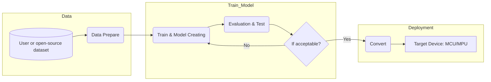

# NuEdgeWise
NuEdgeWise is a Tiny ML toolkit for training models and deploying them with TensorFlow Lite on Nuvoton MCUs/MPUs.

- The tools are provided as Jupyter Notebooks with a user-friendly interface that simplifies the Tiny ML workflow.
- Nuvoton MCUs use TensorFlow Lite for Microcontrollers (TFLM) as the inference framework. NuEdgeWise produces TensorFlow Lite (TFLite) models and Vela-compiled TFLite models for Arm Ethos-U NPUs.
- Install the Python environment once ([step 2](#2-installation--env-create)), then pick any tool from the [Tool Table](#1-tool-table) ([step 3](#3-choose-your-use-case)).

## Contents
1. [Tool Table](#1-tool-table)
2. [Installation & Env Create](#2-installation--env-create)
3. [Choose Your Use Case](#3-choose-your-use-case)
4. [Workflow](#4-workflow)
5. [Deploy Your Own TinyML Model](#5-deploy-your-own-tinyml-model)
6. [MCU ML Firmware](#6-mcu-ml-firmware)

## 1. Tool Table
| Tool | Use Case | Model | M55M1 |M467|MA35D1|Description |
| :-- | :-- | :--| :--|:--|:--|:--|
| [ML_KWS](https://github.com/OpenNuvoton/ML_KWS)  | Keyword Spotting | DNN/DS-CNN | :heavy_check_mark: |:heavy_check_mark:|:small_blue_diamond:| Keyword spotting with a small vocabulary (<=1s). |
| [ML_G-Sensor](https://github.com/OpenNuvoton/ML_G-Sensor) | Gesture Recognition Magic Wand  | CNN| :small_blue_diamond:| :heavy_check_mark:|:small_blue_diamond:|Classifies gestures from 3-axis accelerometer readings. Includes data collection support.|
| [ML_Image_Classification](https://github.com/OpenNuvoton/ML_Image_Classification) | Image Classification | MobileNet/efficientnet/fdmobilenet/shufflenet | :heavy_check_mark:|:small_blue_diamond: (shufflenet) |:small_blue_diamond:|Uses transfer learning and fine-tuning from ImageNet-pretrained models such as MobileNet. You can train further with your own data.|
| [ML_YOLO](https://github.com/OpenNuvoton/ML_YOLO) | Object Detection | Yolov8-nano/YoloX-nano/Yolo Fastest v1.1| :heavy_check_mark: |:x:|:heavy_check_mark:|Trains YOLO-series models with PyTorch or Darknet and converts them into fully quantized TFLite models for easy deployment.|
| [ML_Gearbox_Fault_Diagnosis](https://github.com/OpenNuvoton/ML_Gearbox_Fault_Diagnosis) |Anomaly Detection | DNN/Autoencoder | :small_blue_diamond:|:heavy_check_mark:|:small_blue_diamond:|A basic Tiny ML example: train a model, convert it to TFLite, and deploy it on an EVK.|
| [ML_VWW](https://github.com/OpenNuvoton/ML_VWW) | Visual Wake Words | Small MobileNet RGB/gray | :heavy_check_mark:|:heavy_check_mark:|:small_blue_diamond:|Detects whether a person (or another object of interest) is present in an image. |
| [ML_Object_Detection](https://github.com/OpenNuvoton/ML_Object_Detection) (⚠️ Deprecated) | Object Detection | SSD_MobileNet_fpnlite v2/v3 | :heavy_check_mark: |:x:|:heavy_check_mark:| Deprecated; use [ML_YOLO](https://github.com/OpenNuvoton/ML_YOLO) for new object detection projects. Based on the TensorFlow Object Detection API, using small models suited to MPU edge devices. SSD_MobileNet_fpnlite_v3 requires a TensorFlow 1 environment; see the repository for details.|

- :heavy_check_mark: : The model runs on the device, and example board inference code is provided.
- :small_blue_diamond: : The model runs on the device, but you need to develop your own inference code.
- :x: : The model cannot currently run on the device.

## 2. Installation & Env Create
### A. Install Conda
- NuEdgeWise uses Python 3.9. If you are already familiar with Python virtual environments, you can skip this step.
- Install conda using [Miniforge](https://github.com/conda-forge/miniforge) (recommended) or Anaconda.

### B. Create the NuEdgeWise Virtual Environment
1. Open the Miniforge Prompt.
2. Create the environment: `conda create --name NuEdgeWise_env python=3.9.13`
3. Activate it: `conda activate NuEdgeWise_env`
4. Get this repository (`git clone` or download the ZIP), go to the `NuEdgeWise/` folder, and run `python -m pip install -r requirements.txt`.

- Windows users can run [launch.bat](launch.bat) to execute these steps at once. Update `MODEL_SRC_DIR` in the script if Miniforge is not installed in `C:\ProgramData\miniforge3`.
- This environment covers almost every tool. The following need additional installation steps, described in their own repositories:
  - [ML_YOLO](https://github.com/OpenNuvoton/ML_YOLO): YOLOv8-nano and YoloX-nano.
  - [ML_Object_Detection](https://github.com/OpenNuvoton/ML_Object_Detection) (⚠️ Deprecated).

### C. Alternative: Docker (CPU Only)
1. Clone [ML_KWS](https://github.com/OpenNuvoton/ML_KWS) and [ML_Image_Classification](https://github.com/OpenNuvoton/ML_Image_Classification) into the same parent folder as `NuEdgeWise/` ([docker-compose.yml](docker-compose.yml) mounts them from `../`).
2. In `NuEdgeWise/`, build the image: `docker build -t nuedgewise:v1 .`
3. Run the container: `docker compose run nuedgewise`

## 3. Choose Your Use Case
1. Download the tool repository you need from the [Tool Table](#1-tool-table).
2. Open Miniforge (or your Python environment) and activate `NuEdgeWise_env`.
3. Follow the README of that tool and run its Jupyter notebooks.

Each tool also provides example inference code for Nuvoton MCU/MPU devices (see the legend under the [Tool Table](#1-tool-table)).

## 4. Workflow
Figure 1: General workflow of the NuEdgeWise tools.

- Every tool supports training on custom datasets and converting the result to deployment-ready formats such as TFLite or TFLite for Microcontrollers (C/C++ source).
- [ML_KWS](https://github.com/OpenNuvoton/ML_KWS) and [ML_G-Sensor](https://github.com/OpenNuvoton/ML_G-Sensor) can also collect your own dataset with a Nuvoton EVK board.
- [ML_Image_Classification](https://github.com/OpenNuvoton/ML_Image_Classification), [ML_VWW](https://github.com/OpenNuvoton/ML_VWW), and [ML_YOLO](https://github.com/OpenNuvoton/ML_YOLO) also support the Vela compiler for MCU + NPU use cases. For other models, use [convert_model/vela](convert_model/vela) as a reference.

## 5. Deploy Your Own TinyML Model
### A. Keras/TensorFlow
- [convert_model/keras_converting.ipynb](convert_model/keras_converting.ipynb) demonstrates converting a Keras/TensorFlow model to TFLite (with or without quantization) and deploying it on a Nuvoton MCU.

### B. PyTorch
The conversion path is PyTorch → ONNX → TFLite.
1. Export the PyTorch model to ONNX with PyTorch's built-in exporter: [Export a PyTorch model to ONNX](https://docs.pytorch.org/tutorials/beginner/onnx/export_simple_model_to_onnx_tutorial.html).
2. Convert ONNX to TFLite with [PINTO0309/onnx2tf](https://github.com/PINTO0309/onnx2tf). Follow its installation guide (recent versions require Python 3.10 or later, so use a separate environment). For Nuvoton devices, use the INT8 quantization commands below:
   ```
   # INT8 Quantization, Full INT8 Quantization
   # INT8 Quantization with INT16 activation, Full INT8 Quantization with INT16 activation,
   # Dynamic Range Quantization

   # INT8 Quantization (per-channel)
   onnx2tf -i emotion-ferplus-8.onnx -oiqt
   # INT8 Quantization (per-tensor)
   onnx2tf -i emotion-ferplus-8.onnx -oiqt -qt per-tensor
   ```
3. For full INT8 quantization, prepare calibration data. See [Calibration data creation for INT8 quantization](https://github.com/PINTO0309/onnx2tf?tab=readme-ov-file#8-calibration-data-creation-for-int8-quantization) and the [YOLOv8n PyTorch to TFLite INT8 example](https://github.com/OpenNuvoton/ML_YOLO/blob/master/yolov8_ultralytics/README.md#4-pytorch-to-tflite-int8).

Alternatively, [LiteRT Torch](https://github.com/google-ai-edge/litert-torch) (formerly AI Edge Torch) converts PyTorch models to TFLite directly.

## 6. MCU ML Firmware
Nuvoton also offers ML application firmware that covers the NuEdgeWise models and more, such as face and body landmark detection.
- [ML_M55M1_SampleCode](https://github.com/OpenNuvoton/ML_M55M1_SampleCode)
- [ML_M460_SampleCode](https://github.com/OpenNuvoton/ML_M460_SampleCode) (private repository; [contact Nuvoton](https://www.nuvoton.com/ai/contact-us/) to request access)
